# trtutils

[](https://pypi.org/pypi/trtutils/)

[](https://www.codefactor.io/repository/github/justincdavis/trtutils)


A high-level Python interface for TensorRT inference, providing a simple and unified way to run arbitrary TensorRT engines. This library abstracts away the complexity of CUDA memory management, binding management, and engine execution, making it easy to perform inference with any TensorRT engine.

## Features

- `TRTEngine` runs any TensorRT engine, with async_v2 and async_v3 backends, CUDA graphs, and pagelocked or unified memory
- `Buffer` inputs on the host or the device; `Buffer.wrap` views NumPy, CuPy, and PyTorch arrays without copying
- Image models in `trtutils.image`: `Detector`, `Classifier`, `Segmenter`, `PoseEstimator`, `OBBDetector`, `DepthEstimator`, `HandInteractionDetector`, and `OCR` (text detection plus recognition)
- SAHI (sliced inference) for any detector, with `SAHI`
- Preprocessing on the CPU, CUDA, or TensorRT (`preprocessor="cpu" | "cuda" | "trt" | "hybrid"`), and CPU or CUDA postprocessing (`postprocessor="cpu" | "cuda"`)
- Pre-configured `trtutils.models` wrappers with `download()` and `build()`
- `Model.build` reads the image size from the ONNX; `embed_sst=True` moves BGR-to-RGB, normalization, and layout into the engine, which then takes uint8 images
- Model download and ONNX export with `trtutils download` or `Model.download()`
- Engine building from ONNX, including FP16, FP8, INT8, strongly typed, DLA, and dynamic-shape builds
- Benchmarking, profiling, and NVTX instrumentation (with Jetson energy/power metrics)
- Comprehensive type hints and documentation

## Installation

trtutils does not pull in CUDA or TensorRT by itself, install the extra matching
your CUDA version:

```bash
# CUDA 13 / Jetpack 7
pip install "trtutils[cu13]"

# CUDA 12 / Jetpack 6
pip install "trtutils[cu12]"

# CUDA 11 / Jetpack 5
pip install "trtutils[cu11]"
```

On Jetson devices, TensorRT is provided by Jetpack, so use the matching `jp5`,
`jp6`, or `jp7` extra instead, which installs `cuda-python` only.

`opencv-python` and `cv2ext` are base dependencies, installed with every extra.

Supported versions:

- Python 3.8 to 3.15. NVIDIA's `tensorrt` wheels cover Python 3.8 to 3.14, so on 3.15 install TensorRT another way
- `cu11` installs TensorRT 10.x (`tensorrt_cu11`, whose last release is 10.13). `jp5` uses the TensorRT 8.x that JetPack 5 already provides
- `cu12` installs TensorRT 10.x (`tensorrt_cu12`, below 11). `jp6` uses the TensorRT that JetPack 6 provides, 8.6 through 10.x
- `cu13` installs TensorRT 10.13 through 10.x (`tensorrt_cu13`). `jp7` uses the TensorRT that JetPack 7 provides. TensorRT 11 is not supported yet

Additional extras:

```bash
# ONNX graph utilities used by the builder
pip install "trtutils[onnx]"

# Numba JIT acceleration for CPU operations
pip install "trtutils[jit]"

# Quantization CLI/API tools (NVIDIA ModelOpt)
pip install "trtutils[quantize]"

# PyTorch and torchvision, for trtutils.compat
pip install "trtutils[torch]"

# SAHI library and Ultralytics, for trtutils.compat.sahi
pip install "trtutils[sahi]"

# Development
pip install "trtutils[dev]"
```

## Quick Start

### Basic Engine Usage

The `TRTEngine` class provides a simple interface for running any TensorRT engine:

```python
import numpy as np

from trtutils import Buffer, TRTEngine

# Load your TensorRT engine
engine = TRTEngine("yolov10n_640.engine")

# Get input specifications
print(engine.input_shapes)  # Expected input shapes
print(engine.input_dtypes)  # Expected input data types

# Run inference: every input is a Buffer, on the host or the device
image = np.zeros(engine.input_shapes[0], dtype=engine.input_dtypes[0])
outputs = engine.execute([Buffer.wrap(image)])  # NumPy arrays are wrapped without a copy

# GPU-resident data (CuPy, PyTorch, ...) is read in place, with no host round trip
outputs = engine.execute([Buffer.wrap(cupy_array)])
```

Inputs are validated against the engine: dtype, rank, static dims, and the
optimization profile of dynamic dims. A dynamic engine runs at exactly the
shape of the Buffers it is given and returns outputs of the matching shape.

### End-to-End Image Models

The task models in `trtutils.image` (`Detector`, `Classifier`, `Segmenter`,
`PoseEstimator`, `OBBDetector`, `DepthEstimator`, `HandInteractionDetector`, and
`OCR`) bundle preprocessing and postprocessing around an engine:

```python
import cv2

from trtutils.image import Detector

detector = Detector("yolov8n.engine", warmup=True, preprocessor="cuda")

image = cv2.imread("image.jpg")
bboxes = detector.end2end([image])[0]
```

### Building and Downloading Models

The wrappers in `trtutils.models` download an upstream model, export it to ONNX,
and build an engine. `build()` reads the image size from the ONNX file.

```python
from trtutils.models import YOLOv8

YOLOv8.download("yolov8n", "yolov8n.onnx")
YOLOv8.build("yolov8n.onnx", "yolov8n.engine")
```

Downloaded models may have license restrictions, which you are responsible for following.

### Command Line

```bash
# download a model and export to ONNX
python3 -m trtutils download --model yolov8n --output yolov8n.onnx

# build an engine
python3 -m trtutils build --onnx yolov8n.onnx --output yolov8n.engine --fp16

# benchmark it
python3 -m trtutils benchmark --engine yolov8n.engine --iterations 1000
```

See the [CLI reference](https://justincdavis.github.io/trtutils/cli.html) for
all commands (`benchmark`, `build`, `build_yolo`, `build_dla`, `quantize`,
`generate_calibration`, `detect`, `classify`, `inspect`, `profile`, `download`,
`trtexec`, `clear_cache`, and more).

## Supported Models

Every family below has a download config. `python3 -m trtutils download --list_models` prints
the exact names accepted by `--model`, and the [documentation](https://justincdavis.github.io/trtutils/models.html)
describes each family.

- **Detection**: YOLOX; YOLOv3, v5, v7, v8, v9, v10, v11, v12, v13, and v26; RT-DETR v1, v2, and v3; D-FINE; DEIM; DEIMv2; RF-DETR
- **Classification**: torchvision classifiers (AlexNet, ConvNeXt, DenseNet, EfficientNet and EfficientNetV2, GoogLeNet, Inception v3, MaxViT, MNASNet, MobileNet, RegNet, ResNet and ResNeXt, ShuffleNet, SqueezeNet, Swin and Swin V2, VGG, ViT, Wide ResNet); DeiT and DeiT III; YOLOv8, v11, and v26 classifiers
- **Segmentation**: YOLOv8, v11, and v26 (`-seg`)
- **Pose estimation**: YOLOv8, v11, and v26 (`-pose`)
- **Oriented bounding boxes**: YOLOv8, v11, and v26 (`-obb`)
- **Depth estimation**: Depth-Anything V1, V2, and V3
- **Hand-object interaction**: HOI-DETR and Hands23
- **OCR**: PP-OCR text detection and recognition

## Documentation

For detailed documentation, including advanced usage, examples, and API reference, visit our [documentation site](https://justincdavis.github.io/trtutils/).

## Examples

Check out our [examples directory](examples/) for more detailed usage examples, including:
- Basic engine usage (`engine.py`) and the Jetson helpers (`jetson.py`)
- End-to-end image models (`image/`: detection, classification, segmentation, pose, OBB, depth, OCR, hand-object interaction, SAHI)
- Engine building (`build.py`, `builder/dla.py`)
- Benchmarking and profiling utilities (`benchmark.py`, `profile_engine.py`)

<!-- BENCHMARK_RESULTS:BEGIN (replaced by the benchmark-results PR) -->
## Performance

| Device            | YOLOv8m                                                                 | YOLOv8n                                                                 |
|-------------------|-------------------------------------------------------------------------|-------------------------------------------------------------------------|
| OrinAGX-64GB      | 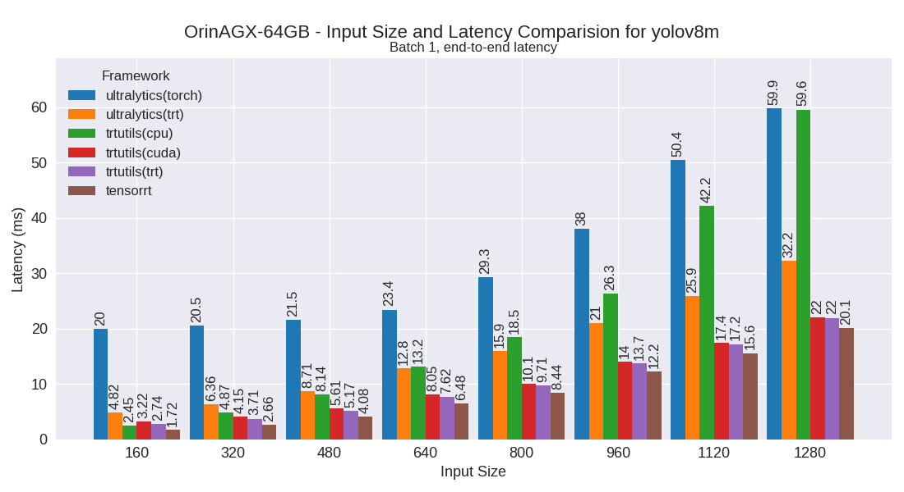       | 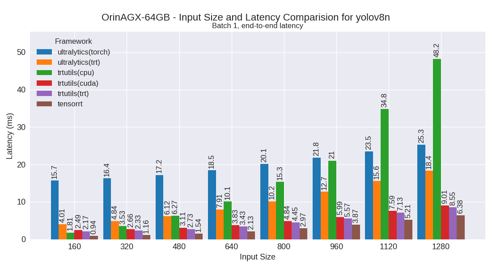       |
| OrinAGX-32GB      | 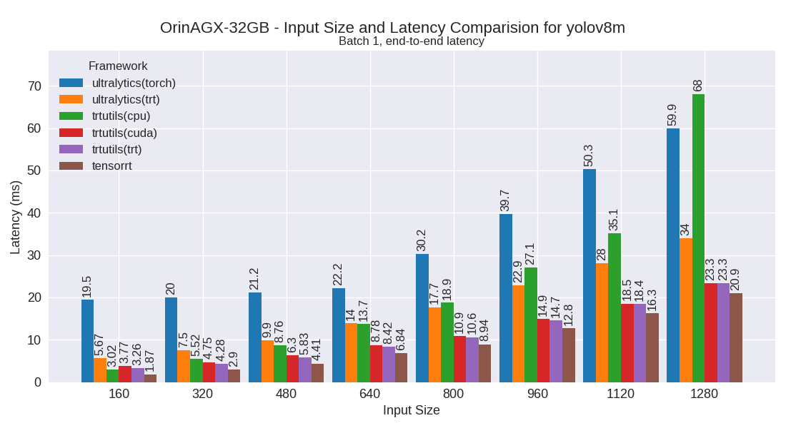       | 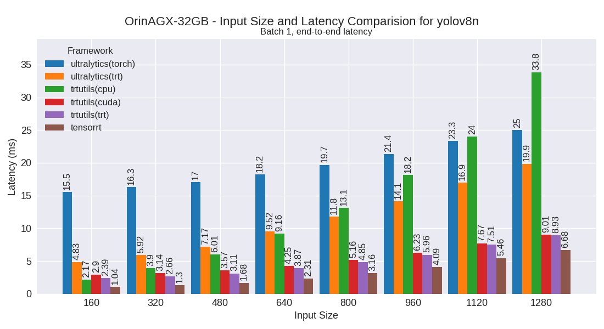       |
| OrinNX-16GB       | 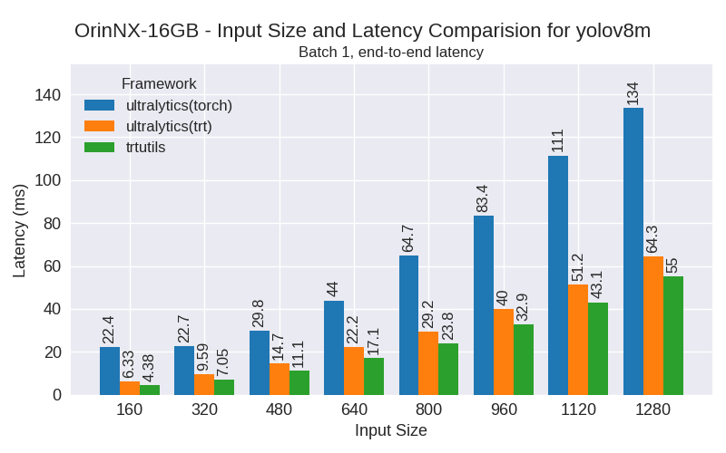         | 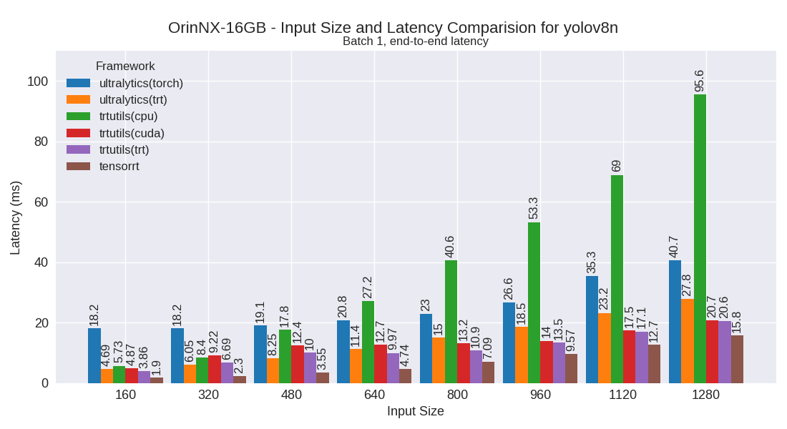        |
| OrinNano-8GB      | 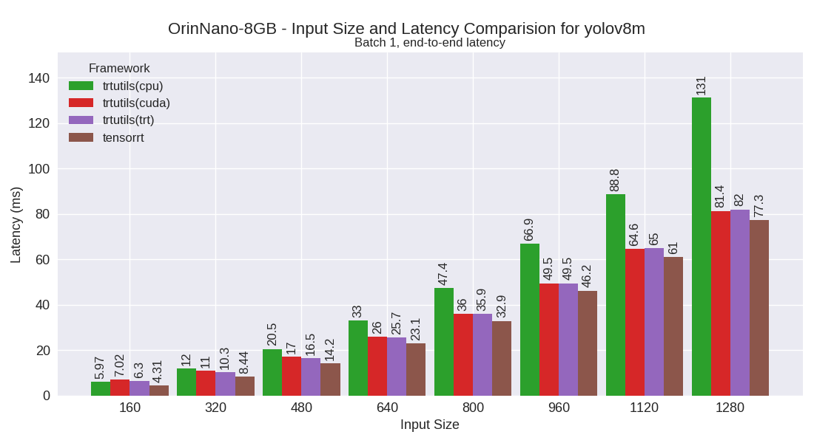       | 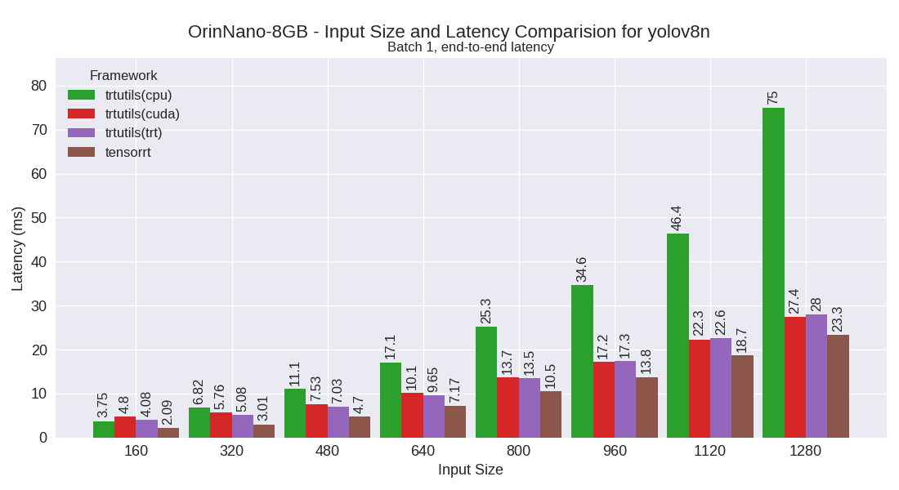       |
| XavierNX-8GB      | 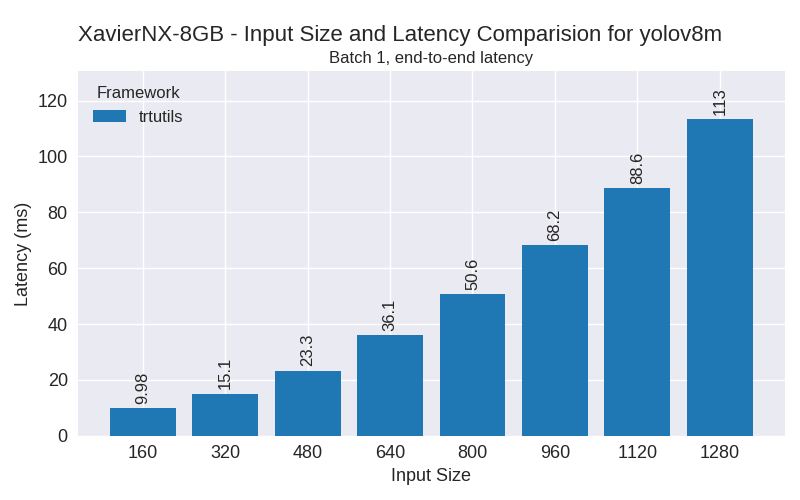       | 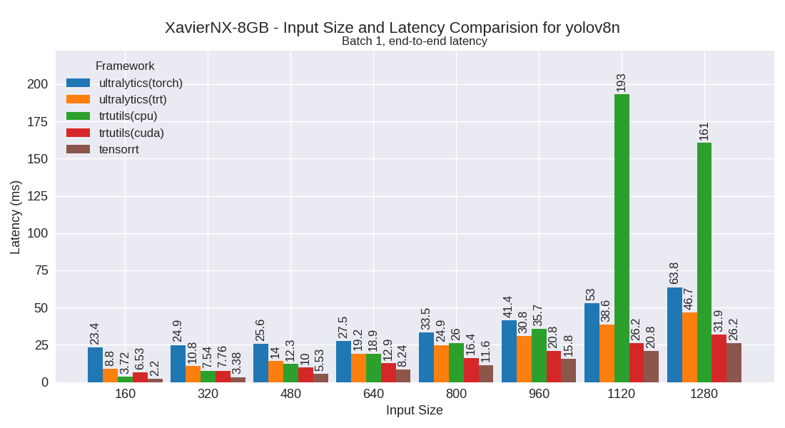       |
| 3090              | 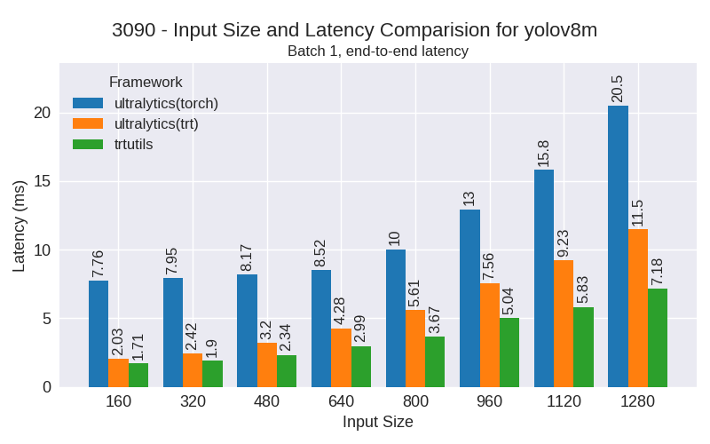                       | 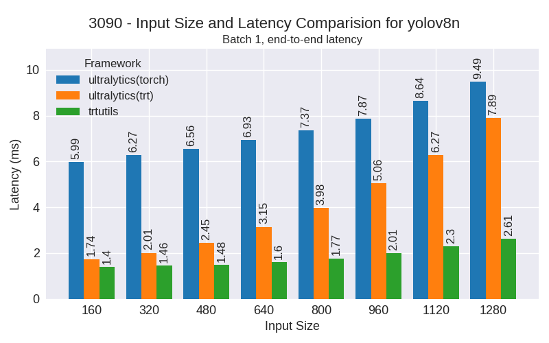                       |
| 3080Ti            | 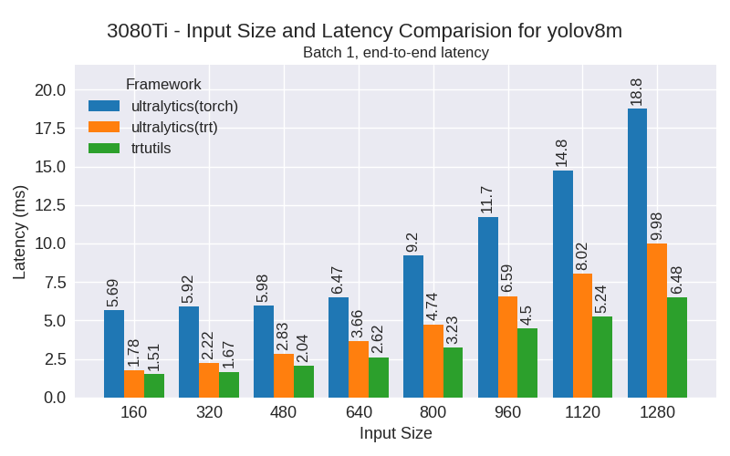                   | 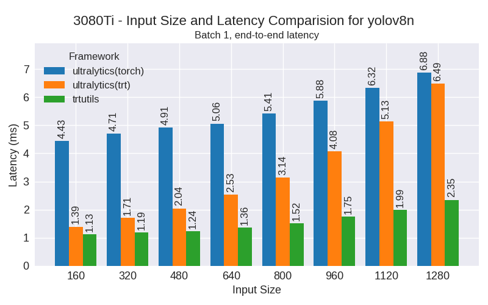                   |
| TitanRTX          | 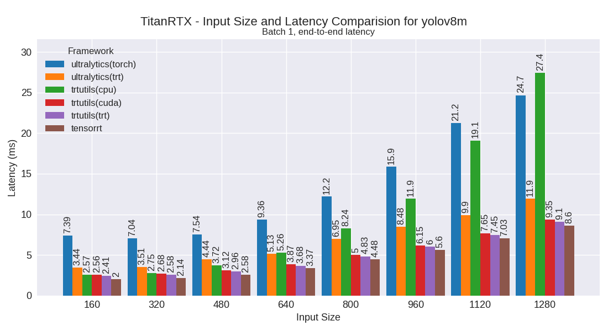               | 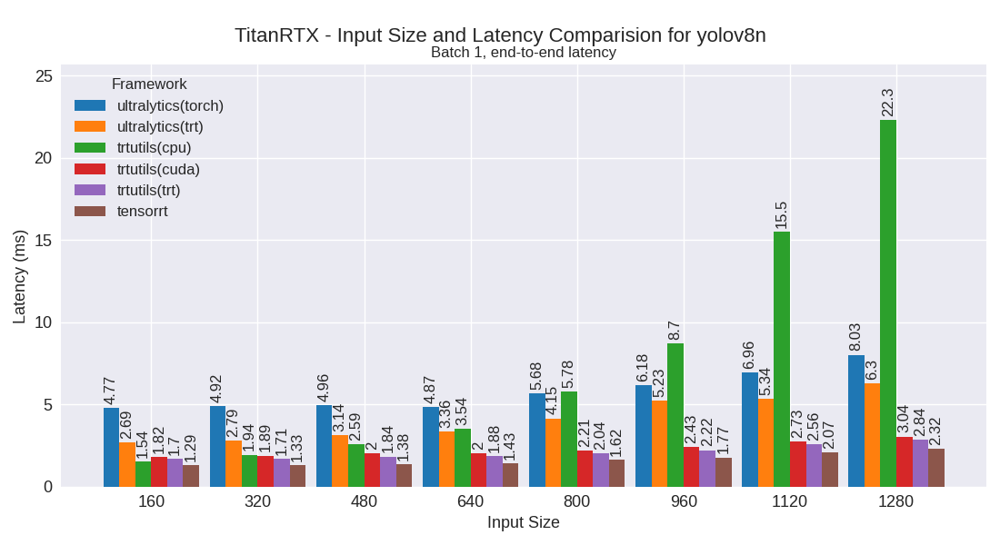               |
<!-- BENCHMARK_RESULTS:END -->

## License

This project is licensed under the MIT License - see the LICENSE file for details.
